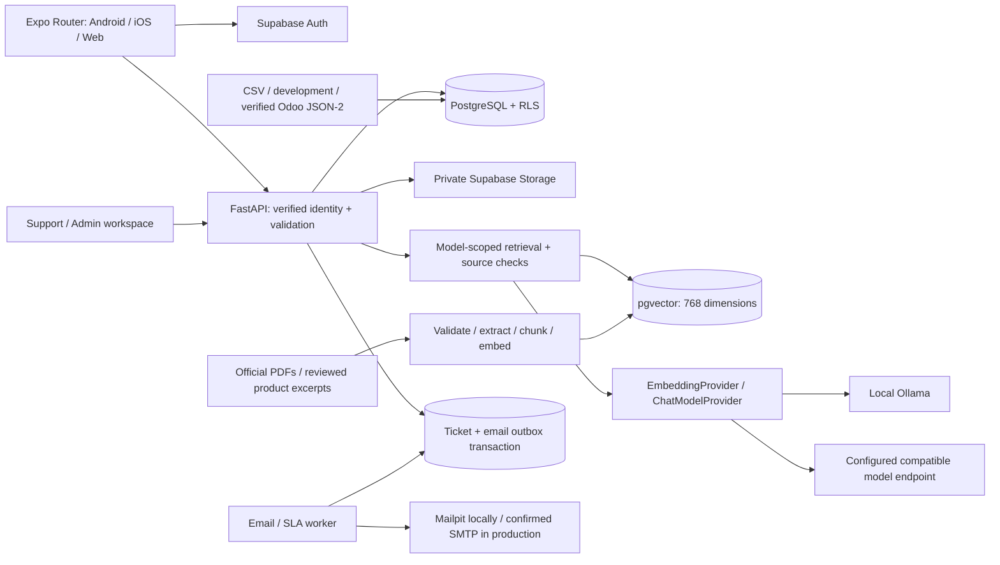

# NICE COMP Support

A working customer-support prototype for Nice Compressors: Expo / React Native mobile and web, FastAPI, relational customer records, product-scoped documentation answers, private receipts and photos, support tickets, SLA calendars, an email outbox, and an authenticated support workspace.

**Delivery status:** the portable web demonstration runs and its customer-to-Mailpit-to-admin flow has been exercised. This is **not production-ready or the full requested definition of done**. Local Supabase, pgvector execution, Ollama inference, live Odoo access, and physical Android/iPhone acceptance have not been validated on the delivery machine. See [acceptance status](docs/ACCEPTANCE.md) and [test report](docs/TEST_REPORT.md). The app name is provisional; brand/product use needs company approval before release.

Start with [LOCAL_DEMO.md](LOCAL_DEMO.md). Public-site findings and source limitations are in [RESEARCH.md](docs/RESEARCH.md).

## Architecture



The primary stack uses Supabase for identity, PostgreSQL, RLS and private storage. The API verifies bearer tokens against `/auth/v1/user`, derives the user from that response, then switches the transaction to the non-bypass `nice_api` database role. Customer identity is never accepted in customer request bodies. The role-to-customer association lives in `customer_profiles`, and only administrators can change it.

The portable fallback uses a separate SQLite file, synthetic accounts with scrypt password hashes, development-only JWTs, private local files, deterministic lexical embeddings, and exact document excerpts. It is useful for reviewing user flows when Docker is unavailable; it is not a substitute for Supabase or AI-provider testing. Production startup rejects these development providers.

## Source layout

```text
apps/mobile/                 Expo routes, feature components, hooks, auth, API client
services/api/app/            FastAPI routes and domain/provider services
supabase/migrations/         PostgreSQL schema, constraints, RLS, private storage, pgvector
knowledge/research/          Public-page text snapshots (not all approved for retrieval)
knowledge/research-index.json  215-page research inventory and hashes
knowledge/reviewed-excerpts.json  Narrowly scoped official product information
knowledge/scripts/ingest.py  Operator ingestion CLI
tests/backend/              Pytest unit / API / isolation / optional Supabase checks
tests/e2e/                  Playwright customer-to-admin flow
tests/maestro/              Native-device smoke-flow definition, not executed here
docs/                       Research, integration, acceptance and test evidence
scripts/                    Development, seed, test and portable-setup entry points
```

## Database

Tables model customers, profiles, products/models, purchases/items, customer assets, warranties, receipts, documents/model applicability/chunks, chat sessions/messages, issue categories, tickets/photos/events, SLA rules, email events, synchronization events and security audit events. Development credentials are isolated in a table with no customer/API-role grants; Supabase mode never uses them.

Every table has RLS enabled in the migrations. Browser database roles are read-only and cannot mutate profiles, tickets, document approval or SLA policy directly. API mutations use the separate restricted role plus operation-specific authorization. Storage has a private bucket and no browser-object policies; a request must pass record ownership checks before the backend signs a URL for 120 seconds. Foreign keys and uniqueness constraints protect source IDs, purchase lines and asset identities.

`document_chunks` keeps text and provenance, a portable JSON vector for test tooling, and a PostgreSQL `vector(768)` column with an HNSW cosine index. Retrieval filters **before similarity search** by the selected owned model, active document, approval, indexing status and embedding provider. Switching embedding dimension requires a migration and complete re-index; changing provider requires re-indexing even if its dimensions match.

## Local installation — full stack

Requirements: Node.js 22.13+ (Node 24 was used here), Python 3.12+, Docker-compatible containers, and enough disk for Supabase images and model downloads. On Windows use PowerShell. Keep all commands in the repository root.

```powershell
python -m venv .venv
.\.venv\Scripts\python.exe -m pip install -r services/api/requirements.txt
npm ci
Copy-Item .env.example .env
Copy-Item apps/mobile/.env.example apps/mobile/.env
npx supabase start
npx supabase db reset
npx supabase status
docker compose up -d
docker compose exec ollama ollama pull nomic-embed-text
docker compose exec ollama ollama pull qwen2.5:1.5b
```

`supabase db reset` destroys data in this **local development project**; do not use it against a production database. Copy the local Supabase API URL, anon key and service-role key into `.env`. Keep `APP_ENV=development`, `EMAIL_PROVIDER=mailpit`, and leave the production recipient unconfirmed. Then:

```powershell
.\.venv\Scripts\python.exe scripts/seed.py
npm run dev
```

On macOS/Linux use `python3`, `.venv/bin/python` and `cp`. `npm run dev` starts the API, outbox/SLA worker and Expo web. `PYTHON_BIN` can point to an existing isolated Python environment. Container services are started separately to keep startup predictable.

Development services: app `http://localhost:8081`, API docs `http://localhost:8000/docs`, Mailpit `http://localhost:8025`, Supabase Studio `http://localhost:54323`. No public site is deployed by these commands.

## Environment variables

The complete template is [.env.example](.env.example). The mobile app receives **only** `EXPO_PUBLIC_API_BASE_URL`; it fetches the public Supabase URL/anon key from `/config`. Never put service-role, database, SMTP, Odoo or model-provider secrets into an Expo variable.

| Group | Configuration |
| --- | --- |
| Runtime | `APP_ENV`, `API_BASE_URL`, `WEB_BASE_URL`, `CORS_ORIGINS` |
| Data / auth | `DATABASE_URL`, `AUTH_PROVIDER`, `STORAGE_PROVIDER`, `SUPABASE_URL`, `SUPABASE_ANON_KEY`, `SUPABASE_SERVICE_ROLE_KEY` |
| Local-only | `DEV_TOKEN_SECRET`, `PRIVATE_STORAGE_DIR` |
| AI | `CHAT_PROVIDER`, `CHAT_MODEL`, `EMBEDDING_PROVIDER`, `EMBEDDING_MODEL`, `OLLAMA_BASE_URL`, `MODEL_API_URL`, `MODEL_API_KEY` |
| Integration | `POS_CONNECTOR`, `ODOO_BASE_URL`, `ODOO_DATABASE`, `ODOO_USERNAME`, `ODOO_API_KEY`, `ODOO_MAPPING_FILE`, `ODOO_API_VERIFIED` |
| Mail | `EMAIL_PROVIDER`, `SUPPORT_OWNER_EMAIL`, `PRODUCTION_RECIPIENT_CONFIRMED`, `SMTP_HOST`, `SMTP_PORT`, `SMTP_USERNAME`, `SMTP_PASSWORD`, `SMTP_FROM_EMAIL`, `SMTP_STARTTLS` |

Configuration secrets remain on the backend. The generated local `.env`, private files and SQLite database are ignored and excluded from the source archive. Seed passwords are explicit synthetic development credentials, not company credentials.

## Knowledge ingestion and answers

Use Admin → Knowledge to upload a PDF, enter its official source URL/version/family and verified applicable model IDs, index it, and explicitly approve its model scope. Indexing does not activate it. Deactivate a previous version before activating a replacement with the same source URL. Failed ingestion stays visible to staff and cannot be retrieved.

The CLI is available for an operator:

```powershell
.\.venv\Scripts\python.exe knowledge/scripts/ingest.py --url https://www.nicecompressors.net/PATH-TO-VERIFIED-MANUAL.pdf --title "Verified manual title" --version "Company document version" --family "Verified product family" --model MODEL-UUID
```

The URL above is an instructional placeholder, not an invented company manual. Supply a real verified URL. Official HTTPS domains are allowlisted, redirects are revalidated, downloads are limited, encrypted/scanned PDFs fail explicitly, page numbers survive chunking, and multiple-model HTML tables require separately reviewed per-model excerpts. `knowledge/research/` is an inventory, **not automatically trusted RAG content**.

Ollama implements both model interfaces. `CHAT_PROVIDER=openai_compatible` supports a configured HTTPS endpoint exposing `/chat/completions`; other vendors require their own small provider adapter. Azure, Gemini and Anthropic native adapters are not claimed as implemented. The model selects evidence; code accepts only whole source excerpts, retaining qualifiers and citations. Missing oil, pressure, voltage, torque or maintenance information returns the unverified response. Hazardous requests trigger escalation without invented shutdown steps. This conservative answer style is intentional.

## Purchases, warranties and POS

See [ODOO.md](docs/ODOO.md) for activation details and the CSV/JSON schema. The public site identifies Odoo SaaS 19.3; private API entitlement and model fields are not known. The Odoo adapter is disabled until they are verified. CSV imports validate all rows and run atomically, resolve model mappings, preserve account ownership and avoid duplicate orders/lines/assets. No private website scraping is used.

Explicit warranty dates with evidence may be synchronized. Administrators can record verified purchase-policy, serial, explicit POS or manual dates through the API, and manual adjustments through Admin → Records. No company duration is automatically inferred. Purchase-policy date derivation is currently an operator responsibility; automatic policy calculation needs the company's approved rules. The terms-page wording is not applied as a blanket entitlement.

Receipt PDFs can be imported through Admin → Records and viewed privately as rendered pages inside the app on every platform. Customer download/share controls are deliberately absent pending company requirements; no browser-rendered content can be made impossible to capture.

## Ticketing, SLA and email

Ticket creation validates ownership and category, locks attached photos, applies safety severity escalation, computes configured business-hour deadlines, records an initial event and inserts one email outbox item in a single database transaction. A client UUID makes repeated submissions idempotent. Photos are resized on device, decoded/validated again on the server, stripped of EXIF, and stored privately. Up to six are accepted per ticket.

SLA rules configure severity, response/resolution business minutes, timezone, weekdays, opening/closing hours and an escalation threshold. No test target is shown to customers as an official commitment. The worker creates one overdue-escalation event per response/resolution target; the admin view flags overdue responses. Escalation currently means an internal support-review event, not routing to multiple external contacts. Holiday calendars, split shifts and multiple escalation recipients require company policy and a follow-up extension.

SMTP sends occur after ticket commit. The durable outbox retries failures with bounded exponential delay, up to eight attempts; admins can explicitly requeue failed messages. Delivery is at-least-once: a process failure after SMTP accepts a message can produce a duplicate. Stable Message-ID helps mail systems correlate it. Mailpit always rewrites the recipient to `support@nicecomp.test`; development cannot use production SMTP. Production needs a confirmed recipient and STARTTLS. Emails contain the reviewed problem/context and a link to authenticated ticket/photo review, not public photo URLs.

## Testing

```powershell
npm run test
npm run test:ui
npm run typecheck
npm run build:web
npx playwright install chromium
npm run test:e2e
```

Browser tests require the app/API/worker/Mailpit already running and the development seed. They submit synthetic records. Backend tests isolate their own SQLite databases. If your system temp directory is restricted, add `--basetemp=.local/pytest-run` to the direct pytest command, choosing a fresh directory.

For Supabase acceptance, start and seed the full local stack, set `RUN_SUPABASE_ACCEPTANCE=1`, `ACCEPTANCE_SUPABASE_URL` and `ACCEPTANCE_SUPABASE_ANON_KEY`, then run `tests/backend/test_supabase_acceptance.py`. That test exercises real Supabase login, cross-customer RLS, role-edit denial and raw storage denial. It is skipped otherwise. The full Supabase/Ollama browser flow must also be run before acceptance. [TEST_REPORT.md](docs/TEST_REPORT.md) distinguishes executed and unexecuted checks.

## Android, iOS and web

See [LOCAL_DEMO.md](LOCAL_DEMO.md) for LAN IP configuration and Expo Go. Android emulator access normally uses `10.0.2.2` for the host API. Physical Android/iPhone must use the laptop's LAN address, with both devices on the same private network. Windows cannot run Apple's iOS simulator. An iPhone with Expo Go can review without App Store publication, subject to the installed Expo Go supporting this SDK. Native camera, permission and receipt behavior still need device acceptance.

## Troubleshooting

| Symptom | Action |
| --- | --- |
| Cannot reach backend | Confirm port 8000 and `EXPO_PUBLIC_API_BASE_URL`; a phone cannot use the laptop's `localhost`. |
| Account awaiting association | Create/provision its profile via Supabase Auth and have an admin verify its POS customer mapping. |
| No indexed answer | Confirm active/approved document, exact model association, matching embedding provider, and indexed status. |
| AI unavailable | Start Ollama; pull both models; inspect server operational logs. Never fabricate a fallback specification. |
| PDF rejected | Verify magic bytes, size and readable text. The currently advertised public brochure URLs returned HTML. |
| Email pending/retry | Start the worker and Mailpit, inspect Admin → Integrations, then retry if needed. |
| Photo/file expired | Refresh the ticket/receipt to request new two-minute links. |
| Supabase unavailable | Start Docker and `npx supabase start`; the portable mode is a separate review option. |
| 409 duplicate/conflict | Refresh; retry with the same ticket idempotency key, or fix the conflicting source mapping. |

## Production preparation

Do not expose this development instance publicly. Resolve the acceptance items first: real manuals/model applicability, verified Odoo mapping, approved SLA/warranty policy, email recipient/domain, company branding/name approval, real-device QA and the outstanding dependency advisories. Use managed secrets, HTTPS, explicit CORS origins, database backups with restore drills, dedicated API/worker database logins, centralized rate limiting, monitoring and an approved data-retention schedule. Disable development accounts, public signup and development providers. Run RLS tests on the exact deployed migrations. Review SMTP/privacy requirements and app-store policies with the company.

Structured logs record route templates, request IDs, timing, retrieval counts, ingestion IDs, sync counts and email states. Passwords, tokens, file-link tokens and chat contents are not logged. Run Uvicorn with `--no-access-log` to avoid logging temporary file tokens. Staff operations also create audit records. Production deployment manifests, managed cloud provisioning and store submission are not part of the validated local delivery.
